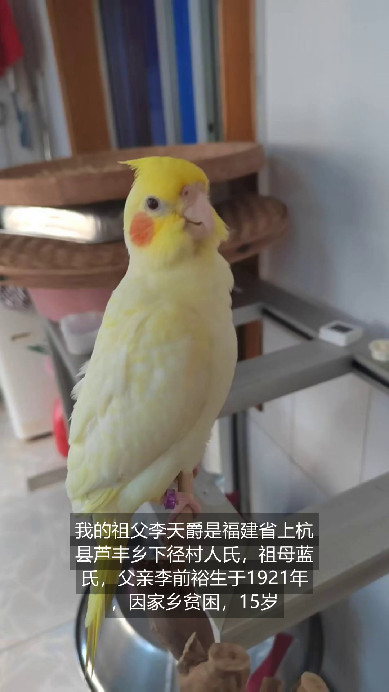
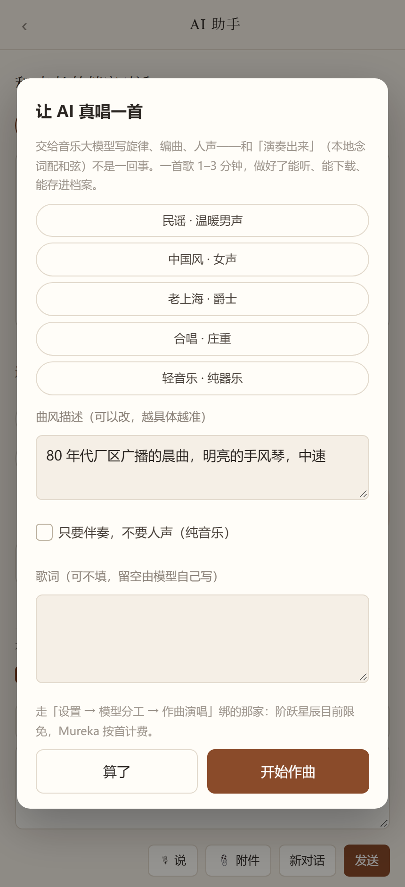

# 岁月记录助手 · The Story of My Life

**当前版本 v0.9.20**（2026-10-30）

变更明细见 [CHANGELOG.md](CHANGELOG.md)｜**给第一次用的人：[使用说明](docs/使用说明.md)**｜
里程碑 2 存档见 [docs/MILESTONE-2.md](docs/MILESTONE-2.md)｜
里程碑 3 任务表见 [docs/TASKS-v0.5-PROGRESS.md](docs/TASKS-v0.5-PROGRESS.md)｜功能方案见 [docs/PLAN-v0.5-FEATURES.md](docs/PLAN-v0.5-FEATURES.md)

> **里程碑 1（v0.2）**：一个人在一台电脑上把档案做出来。
>   
> **里程碑 2（v0.4）**：换到手机上也能完整走完，而且一家人各用各的 —— **已在小米 9、荣耀 50 两台真机全链路实测通过。**

一个人，一本档案。老人把一生讲出来，系统自动排成有封面、有目录、有时间轴的卷宗。

**一个 SQLite 文件 + 一套纯 JS 前端 + 两种宿主（浏览器 / 安卓 WebView）。零 npm 依赖，零构建。**

## 现在能做什么

- **手机号注册登录**，每个账号一个独立数据库（`data/users/<uid>/archive.db`），**数据物理隔离**，换账号看不到别人的
- 讲述、照片、条目、章、整本档案**全可改可删**
- **录音 → 试听 → 转文字**：安卓走原生 `AudioRecord`（绕开 WebView 权限问题），网页走 `getUserMedia`；
    
  转写走免费语音模型，模型不存在会**自动换一个**
- 一键**导出 / 导入**：整本档案装进一个 `.mylife.json`，换机、备份、分享都靠它；
  也能**直接导入 Word**（自己导的和第三方写的都认，标题 1 分章、图片一起进来）；
  导入撞库会先问你是**覆盖 / 另存副本 / 取消**，不会再默默多出一本同名的
- 每段后面可**传**图片 / 视频 / 录音，直接排进卷宗
- 模型配置**按能力过滤**：填一个 Key 自动配好三个基础环节，免费/付费一目了然
- **封面与头像**：封面工坊可选图/裁切/换版式（4 套）与字体主色；头像独立存储，自动出三档缩略图
- **时间轴**：四类内容按年份摆成一条线，任意时间点插入文字 / 图片 / 音频 / 视频，年份自动归章
- **导出成册**：印刷版 HTML、**PDF**（本地 Chrome 打印）、**Word**（可编辑）、**PPT**（一页一章，聚会放映）
- **AI 助手**：五个角色（采访者 / 编辑 / 编剧 / 音乐人 / 史官），语音或文字输入，逐字流式回复，**回复可一键插回档案**
- **助手八种用途**：聊天 / 看图说话 / 画图 / 做视频 / **图片识字（OCR）** / **语音转文字** / **合成语音** /
  **写歌 · 作曲**——一个框里切换，不懂 AI 也能直接用；
  对话框顶部可**自己挑模型**（只列当前用途能用的模型，不会拿文本模型去画图）
- **按章节给 AI 看原文**：整本太多就点「选章节…」勾几章，只把这几章发给模型（可全选 / 清空 / 记住）
- **用量记账与任务队列**：调过几次模型、花了多少，随时可查；耗时任务进队列，可看进度、可取消
- **朗读有音色也有配乐**：系统音色离线可用；云端音色按句合成并**缓存**（同一句只花钱一次）；
  六套程序化氛围自动避让朗读（不占体积、不涉版权）
- **主题曲**：从档案生成三段式歌词，可改、可念（TTS+配乐）、可存为这本档案的主题曲
- **AI 作曲演唱**：接真音乐大模型（阶跃星辰 StepAudio 3 / Mureka）**作一首完整的歌**——
  有旋律、有人声、有编曲，可选曲风、可自带歌词、可只要伴奏；作好的歌出现在档案首页「写的歌」，
  能播、能下载、能删。同样的要求不会重复扣费，想重来点「再来一版」
- **润色**：条目上点「润」，五种风格出稿，左右并排看字符级差异，**采纳前原文另存一份**，可随时退回
- **剧本**：一章口述 → 3–6 场戏（场景头 / 人物 / 动作 / 对白），只用档案事实，缺的标 [待考]；
  可打印（A4 剧本版心）也可导出 .txt
- **插图**：按条目画那个年代的画面（硅基流动 Kolors 实测 4–5 秒一张），六种画风 +
  **人物设定卡**保持前后一致；生成的图带「AI 生成」标识，满意就一键存进档案
- **内置 ffmpeg**：渲染引擎随 exe 一起分发（146MB 单文件），首次用到自动解到 `data/bin/`
- **漫画**：一章讲述按讲述顺序排成竖版分页（2/4/6 格），气泡就是原话、点一下就能改，
  缺图的格子留虚线框；可导出网页版（单文件带走）/ 逐页图片 / 打印
- **AI 生视频**：在对话页直接让模型出一段视频（硅基流动两段式），成片当场落盘
  （外链 1 小时失效），同要求不重复扣费
- **短片**：一章（或整本）排成分镜 → **逐格配音** → **合成配乐** → 烧字幕 → 竖屏 1080×1920 mp4；
  没有照片的章节自动出**米色文字卡**而不是黑屏，字幕带实底框，全屏也看得清；
  走任务队列、可看进度可取消，关掉页面也在后台跑；成片登记在档案首页「合成的片子」，能播能下载**也能删**
- - **照片说明随时改**：年份 / 地点 / 事件改完就存（v0.9.11 修掉了"一点保存就报错"的老问题）
- Windows 版**单文件分发**：`MyLife.exe` 拷给别人就能用

## 界面一瞥

| 档案首页 | 助手八种用途 | AI 作曲 |
| --- | --- | --- |
|  |  |  |

| 成片与字幕 | 作曲弹窗 |
| --- | --- |
|  |  |

（截图在 `shots/`，随版本更新。）

---

## 直接跑起来

> 仓库里**不带安装包**——一个 exe 146MB、内置 ffmpeg 61MB，放进 git 会让所有人clone 半天。
> 要包就自己构建：`node tools/build-exe.js` 出 Windows 单文件版，`build-apk.bat` 出安卓包，
> 产物落在 `dist/`，**文件名自带版本号**（`MyLife-v0.9.17-windows.exe` /
> `MyLife-v0.9.17-android.apk`），照着文件名装就不会装到旧包。

### Windows（不想装 Node）

用打包好的单文件版：

```
dist/win/
├── MyLife.exe        双击即可，自动开浏览器；黑窗口关掉就退出
├── resources/        可选覆盖层（想临时改界面时放新文件，不用重打包）
├── data/             你的档案、照片、录音全在这，只有这个目录要备份
└── 使用说明.txt
```

**分发给别人：只拷 `MyLife.exe` 一个文件就能用**（界面已内置）。
  
端口被占时换一个：`set PORT=4401 && MyLife.exe`。卸载就是删文件夹。

### 安卓

装 `dist/MyLife-v0.9.17-android.apk`（认准版本号，`dist/archive/` 里的是旧包）。
  
首次打开会申请麦克风权限；登录后一切在本地跑，不联网也能用（除了调模型）。

> 装完在「设置 → 关于」能看到版本号 v0.9.17，用来确认装对了。

### 改代码

```bash
node server/server.js        # → http://127.0.0.1:4321
```

需要 Node 22+（用内置的 `node:sqlite`，**不用装任何依赖**）。

重新打包：

```bat
node tools/build-exe.js      :: Windows 单文件 + 冒烟测试
build-apk.bat                :: 安卓 APK
python tools/make-backup.py  :: 全量备份包（源码 + EXE + APK）
```

**不想在本机装环境？用 GitHub 云端打包**：仓库自带 `.github/workflows/build.yml`，
进仓库 Actions 页选 **build → Run workflow**（或推一个 `v*` 标签），
一次出齐四个平台的包，跑完在 Artifacts 里下载：

| 产物 | 平台 | 说明 |
| --- | --- | --- |
| `MyLife-windows` | Windows | 单文件 `.exe`，内置 ffmpeg |
| `MyLife-linux` | Linux x64 | 单文件，内置 ffmpeg |
| `MyLife-macos` | macOS（Apple Silicon） | 单文件，ad-hoc 签名；被拦时 `xattr -cr MyLife` |
| `MyLife-android` | 安卓 | debug 签名 APK，装上就能用 |

---

## 和旧版的区别

旧版（`D:\works\mystory`）是 Node 服务端渲染；这一版照 `D:\myapps\foread` 的骨架重建：

|      | 旧版             | 这一版                                    |
| ---- | -------------- | -------------------------------------- |
| 后端接口 | 30+ 个业务接口      | **4 个**（query / exec / ai / file）      |
| 业务逻辑 | Node 里         | **全在 `web/db.js`，一份**                  |
| 界面   | 服务端拼 HTML      | 前端渲染，两端同一份                             |
| 安卓   | 没做（Node 跑不进手机） | **Java + WebView，一条命令出 APK**           |
| 账号   | 无              | **手机号注册 + 每用户独立库**                     |
| 出包   | 无              | `build-apk.bat` / `tools/build-exe.js` |

---

## 目录

```
mylife1/
├── web/            一套前端（两端共用）
│   ├── index.html
│   ├── style.css
│   ├── api.js      唯一的后端入口（含 token 注入、数值列归一化、流式对话）
│   ├── db.js       全部 SQL 与生成规则 ★
│   ├── app.js      界面与交互
│   ├── cover.js    封面工坊（版式 / 取景 / 头像缩略图）
│   ├── timeline.js 时间轴与任意时间点插入
│   ├── export.js   文档模型 + 印刷版 HTML + 一键 PDF
│   ├── export-docx.js / export-pptx.js   Word / PPT 渲染器
│   ├── chat.js     AI 助手（八种用途 / 选章节 / 自选模型 / 流式 / 插回档案）
│   ├── song.js     主题曲与 AI 作曲（歌词 / 念白 / 配乐 / 真音乐大模型）
│   ├── polish.js   润色（字符级 diff / 原文存档 / 可退回）
│   ├── script.js   剧本（分场 / 解析 / 打印与 txt）
│   ├── art.js      插图（六种画风 / 人物设定卡）
│   ├── comic.js    漫画（分格 / 中文气泡换行 / 三种导出）
│   ├── movie.js    短片（分镜编辑 / 进度 / 播放下载）
│   ├── mixer.js    配乐（六套程序化氛围 / 自动避让）
│   └── vendor/     docx 与 pptxgenjs（构建期依赖，运行时零安装）
├── server/
│   ├── server.js   网页端宿主（含内联的账号模块，SEA 单文件入口）
│   └── schema.sql  建表，两端共用
├── android/        安卓宿主
│   └── app/src/main/java/com/mylife/archive/
│       ├── MainActivity.java   壳 + 权限 + 原生 TTS + 选图/录音桥
│       ├── LocalServer.java    本地 HTTP（查询/执行/AI/文件 + /files 静态服务）
│       ├── Auth.java           PBKDF2 密码哈希 + 会话令牌
│       ├── Db.java             开库 / query / exec / ensureSchema
│       ├── Ai.java             代理调模型（Key 不进前端）+ 手写 multipart
│       ├── MicRec.java         原生 AudioRecord 录音（WAV）
│       ├── Files.java          base64 落盘
│       └── Json.java           null 安全取值
├── tools/
│   ├── sync.js          把 web/ 同步进安卓 assets
│   ├── build-exe.js     出单文件 EXE + 冒烟测试 + 产物版本命名
│   ├── fetch-ffmpeg.js  拉内置渲染引擎
│   ├── reset-password.js / .bat   离线重置账号密码（不动档案）
│   └── make-backup.py   出全量备份包
├── test/                40 个审计脚本，800+ 项（见文末「测试」）
├── docs/                升级方案与里程碑存档
└── build-apk.bat        一条命令出 APK
```

---

## 构建环境（已在本机验证）

```
JAVA_HOME    D:\jdk-17.0.19.10-hotspot
ANDROID_HOME D:\androidsdk\android-sdk-windows
GRADLE_HOME  D:\gradle-8.7
```

> 内存紧张时 Gradle 会报 `os::commit_memory failed`。构建期间别同时开无头浏览器审计，
>   
> 并给 Gradle 小堆：`-Xmx512m -XX:MaxMetaspaceSize=256m -XX:+UseSerialGC`。

---

## 设计要点

### 1. 后端只做「SQLite 和文件的代理」

```
POST /api/query  {sql, params}     -> rows[]
POST /api/exec   {sql, params}     -> {changes, lastId}
POST /api/ai     {messages}        -> {text}
POST /api/asr    {path, model}     -> {ok, text, ms}
POST /api/file   {op, save|read|del|list, ...}
GET  /files/<rel>                  -> 二进制，支持 Range
```

SQL 写死在 `web/db.js` 里，前端只传参数值，全部走 `?` 绑定。后端不懂业务，所以**业务逻辑只有一份**——改需求只改 JS，两端同时生效。

### 2. 安卓里也起 HTTP 服务

`LocalServer.java` 用 `ServerSocket` 起在 `127.0.0.1` 的随机端口，WebView 加载 `http://127.0.0.1:<port>/`。

好处：网页端和安卓端是**同一个 URL 形态**，前端不需要任何 `if (安卓)` 分支；图片视频走 `/files/*` 直链，不用转 base64。

### 3. 数据隔离靠物理分库，不靠 WHERE

每个用户在磁盘上有自己的一套 `archive.db` + `files/`，请求进来先验 token 拿 `uid`，
  
再用 `AsyncLocalStorage`（Node）/ `Map<Long, Db>`（安卓）把**当前请求该用哪个库**注入进去。

业务 SQL 里**一句 `WHERE user_id=?` 都没有**——漏写一个条件就把数据串了，靠物理隔离才安全。

### 4. 只有系统能力才走 Bridge

```js
if (window.NativeTTS) window.NativeTTS.speak(text, 0.95);
else speechSynthesis.speak(...);
```

WebView 里的 `speechSynthesis` 在国产机上经常没有中文音色，所以安卓端用原生 `TextToSpeech`。
  
录音同理：安卓端优先走 `NativeRec`（原生 `AudioRecord`），开不了才回退 `getUserMedia`。

### 5. 生成同步做，不要任务队列

年份抽取、分章、切条目、照片归位全是规则运算，加起来不到 120 毫秒。只有「AI 起章名」要等几十秒——那一步**异步补上**，失败了就保持规则名，不影响任何事。

### 6. 前端刻意用 ES5

`XMLHttpRequest` 而不是 `fetch`（WebView 老内核没有），不用箭头函数、模板字符串、可选链。目标用户可能是安卓 6/7 的旧机器。

---

## 数据表

`archives` 档案 · `chapters` 章 · `entries` 条目 · `photos` 照片 ·
  
`segments` 讲述原文 · `media` 随文素材 · `shares` 分享 · `settings` · `ai_profiles` · `ai_slots` ·
  
`users` · `sessions`

见 `server/schema.sql`。两端共用同一份，每次打开库都幂等执行一遍（`ensureSchema`），
  
所以**任何旧版本的库都能被当前版本打开**。

---

## 账号与数据隔离

| 项    | 做法                                                                 |
| ---- | ------------------------------------------------------------------ |
| 密码   | Node 用 `scrypt`，安卓用 `PBKDF2WithHmacSHA256`（65536 迭代），都不存明文         |
| 会话   | 32 字节随机 token，存 `sessions` 表，有效期 30 天                              |
| 防爆破  | 同一账号连续失败 5 次锁 10 分钟                                                |
| 验证码  | 演示期固定 `1234`（接口形态已就位，接短信服务商只需换实现）                                  |
| 存储   | `data/users/<uid>/archive.db` + `data/users/<uid>/files/`          |
| 旧数据  | **第一个注册的账号**自动接管 v0.2 的 `data/archive.db` 与 `files/`               |
| 鉴权通道 | `Authorization` 头 / `Cookie` / `?token=`（后两个给 ``、`<audio>` 用） |

---

## AI 配置中心

设置 → 模型来源。可以加**任意多条**，每条独立：

| 类型          | 地址                                     | 说明                                |
| ----------- | -------------------------------------- | --------------------------------- |
| OpenAI 兼容   | `https://api.openai.com/v1`            | 任何走 `/v1/chat/completions` 的服务    |
| DeepSeek    | `https://api.deepseek.com/v1`          | 官方接口                              |
| 硅基流动        | `https://api.siliconflow.cn/v1`        | 国内可直连，`SenseVoiceSmall` 免费转写      |
| 智谱 bigmodel | `https://open.bigmodel.cn/api/paas/v4` | ⚠️ `glm-asr-2512` 单段 ≤30 秒，长录音会失败 |
| Groq        | `https://api.groq.com/openai/v1`       | ⚠️ 国内被墙，手机端无代理不可用                 |
| 本机 Ollama   | `http://127.0.0.1:11434/v1`            | 不用 Key，跑在自己电脑上                    |
| 自定义 / 内网    | 你自己填                                   | vLLM、中转站等                         |

每条配置的操作：**测试**、**拉模型**（GET `/models`）、**编辑**、**删除**；可停用/启用。
  
「测试」对语音环节会**真发 1 秒静音到 `/audio/transcriptions`**，200 才算通——
  
用对话接口去测 ASR 模型必然 400，那样测不出真假。

> ⚠️ **本机模型的提醒**：标着「本机」的配置（Ollama 等）点「测试」会把模型整个加载进内存——7B 模型约 5–6GB。**没有独立显卡的电脑很慢（单次 20–60 秒）且会把系统压很卡**，日常建议用云端服务；「拉模型」只读清单，几乎不占资源。

### 免费方案（2026-10 实测）

没配 Key 也能用——章节名会按年份和内容自动生成。想用 AI，这几家都免费：

| 平台          | 免费额度                                      | 本项目用什么                                                                   |
| ----------- | ----------------------------------------- | ------------------------------------------------------------------------ |
| **硅基流动**    | 常驻免费档模型                                   | `SenseVoiceSmall` 转文字、`DeepSeek-OCR` 看图、`Hunyuan-MT-7B` 写稿、`Qwen3-8B` 精写 |
| 腾讯云混元       | 首开送 100 万 tokens（1 年），`hunyuan-lite` 永久免费 | `hunyuan-turbos-vision` 看图                                               |
| 智谱 bigmodel | Flash 系列永久免费                              | `GLM-4.6V-Flash` 多模态                                                     |

实测（硅基流动免费档，同一份素材）：

| 模型                              | 用途    | 耗时       | 结果                                                                    |
| ------------------------------- | ----- | -------- | --------------------------------------------------------------------- |
| `tencent/Hunyuan-MT-7B`         | 起章名   | **0.5s** | 《九岁天安门》                                                               |
| `Qwen/Qwen3-8B`                 | 精写    | 11s      | 免费但慢：思考占了 319 tokens                                                  |
| `deepseek-ai/DeepSeek-OCR`      | 看图    | **0.3s** | 描述准确                                                                  |
| `FunAudioLLM/SenseVoiceSmall`   | 语音转文字 | **0.4s** | 「一九五八年」全对，1 小时以内均可                                                    |
| `Qwen/Qwen3-ASR-1.7B`           | 语音转文字 | —        | ❌ 挂在模型列表里，但 `/audio/transcriptions` 不认它（`20012 Model does not exist`） |
| `PaddlePaddle/PaddleOCR-VL-1.5` | 看图    | 43s      | ❌ 慢且答非所问，不推荐                                                          |

API Key 只存在本地 `settings` 表，**永远不下发到前端**；请求由原生侧（Java）或 Node 发出，前端拿不到 Key。

## 语音转文字

录完音不会立刻转——**你点「转成文字」才转**，避免为了一段废话白花钱。转写结果直接回填成讲述原文，并按内容重新识别出年份。

后端 `POST /api/asr {path, model}`，两端各自实现，接口一致：
  
Node 走 `fetch` + `FormData`；安卓走 `Ai.asr` 手写的 multipart（**固定长度，不用 chunked**）。

三条设计：

1. **模型不存在自动换**：命中 `20012 / Model does not exist` 时，在同一家配置里换一个
     
   真正支持转写的模型重试，成功后告诉你「已自动改用 XXX」。优先级：
     
   `sensevoice > teleasr > whisper > glm-asr > qwen3-asr`。
2. **失败要能看见**：失败后展开红色详情面板，列出 HTTP 状态、接口地址、用的配置、
     
   模型名、音频文件与大小、服务端原话。不再把「网络不通」和「模型不存在」混成一句「转不出来」。
3. **录音先能听**：每段都有「试听」，刚录完也立刻弹播放条。先确认录音本身没问题，
     
   再谈转文字——把「平台问题还是程序问题」分开。

> 语音转写出来的年份常常是**中文数字**（「一九五八年」）。`findYear` 同时认「1958」和「一九五八」，不会出现「转出来有年份、档案里却没编上」的情况。

## 朗读与阅读偏好

- **安卓**：系统原生 TTS（`Tts`），逐句朗读 + 逐句高亮 + 进度条
- **浏览器**：`speechSynthesis`，同样的逐句逻辑
- 底部条：慢/快调速（0.6×–1.5×）、当前第几句、停止
- 设置里可调：字号 15–30px、夜间模式、语速

### 关于「老手机能读、新手机没声音」

这是 **Android 11（API 30）的包可见性限制**：App 必须先在 Manifest 里声明

```xml
<queries>
    <intent><action android:name="android.intent.action.TTS_SERVICE" /></intent>
</queries>
```

否则看不到系统 TTS 引擎，`new TextToSpeech()` 直接返回 ERROR。已补上（`AndroidManifest.xml` 顶部）。

另外还做了三件事防同类问题：

1. `setLanguage` 的返回值逐个判断，`LANG_MISSING_DATA` 会明确提示「去系统设置下载中文语音包」
2. 枚举设备上的所有 TTS 引擎，可通过 `NativeTTS.useEngine(pkg)` 换一个
3. 单句超过 900 字自动切分（TTS 对超长文本不可靠）

## 已知限制

- 验证码固定 `1234`，接真实短信服务商需签名与模板报备（演示期设计）
- 长录音没有自动切段，所以**有单段上限的平台（智谱 30 秒）不能直接用**
- Groq 国内被墙；阿里百炼 `paraformer-v2` 每月 10 小时免费但不兼容 OpenAI 接口，未接
- 公网部署未做——现在只在本机 / 本手机上跑，够用也最安全
- 网页端前端刻意 ES5，因此代码风格偏旧（这是为老 WebView 的取舍，不是疏忽）
- **安卓端的云端音色还没接**（`/api/tts` 只在 Node 端）：手机上固定用系统 TextToSpeech，
  离线可用、免费；任务队列与流式对话已在 v0.6.0 补齐
- **安卓上不能合成短片**：没有 ffmpeg，WebView 也扛不住长时间编码。短片页会明确禁用并提示去电脑上做；
  漫画可以排、可以预览，导出走浏览器下载
- **一键 PDF 只在桌面端**：需要本机装了 Chrome 或 Edge；没有就改用「印刷版」按 Ctrl+P 另存为 PDF
- 时间轴排序是「上移 / 下移」按钮，不是拖拽（手机上拖拽误触太多，等分镜编辑器一起做手势）
- **AI 作曲要单独配一家**：硅基流动实测 98 个模型里没有音乐模型，需在设置里加「阶跃星辰」
  （限时免费）或「Mureka」（按首计费）才能作歌；两家都不可用时错误里会带原话并提示换一家
- **安卓上不能作歌 / 生视频**：这两个走 Node 后台任务（要 ffmpeg 与外链落盘），
  手机上会自动禁用并提示去电脑上做
- exe 未做代码签名，首次运行会有 SmartScreen 提示（点"更多信息 → 仍要运行"）

---

## 测试

### 服务端与数据层

```bash
node --experimental-sqlite --no-warnings test/audit.js                # 52 主功能
node --experimental-sqlite --no-warnings test/audit-auth.js           # 21 账号与数据隔离
node --experimental-sqlite --no-warnings test/audit-usermgmt.js       # 20 用户管理与找回密码
node --experimental-sqlite --no-warnings test/audit-query-guard.js    #  9 SQL 越库防护（ATTACH / load_extension）
node --experimental-sqlite --no-warnings test/audit-generate.js       # 13 生成规则
node --experimental-sqlite --no-warnings test/audit-archive-mgmt.js   #  9 档案级改删
node --experimental-sqlite --no-warnings test/audit-asr.js            # 12 转写契约
node --experimental-sqlite --no-warnings test/audit-files.js          # 18 文件鉴权与路径穿越
node --experimental-sqlite --no-warnings test/audit-v05.js            # 56 v0.5 基座（表 / 队列 / 用量 / 时间轴 / 流式）
node --experimental-sqlite --no-warnings test/audit-v06.js            # 18 语音合成与缓存
node --experimental-sqlite --no-warnings test/audit-v08.js            # 16 插图与 ffmpeg 解包
node --experimental-sqlite --no-warnings test/audit-v09.js            # 27 分镜规则 + 真合成一条短片
node --experimental-sqlite --no-warnings test/audit-image.js          #  6 文生图（含参考图降级）
node --experimental-sqlite --no-warnings test/audit-video.js          # 21 AI 视频两段式
node --experimental-sqlite --no-warnings test/audit-song.js           # 15 写歌与演奏
node --experimental-sqlite --no-warnings test/audit-music.js          # 36 AI 作曲（阶跃 / Mureka 两家）
node --experimental-sqlite --no-warnings test/audit-import.js         # 25 Word 与档案包导入
node --experimental-sqlite --no-warnings test/audit-mvdel.js          # 11 成片删除
node --experimental-sqlite --no-warnings test/audit-phmeta.js         #  6 照片元数据
node --experimental-sqlite --no-warnings test/audit-quick.js          # 20 素材箱（随手记）
node --experimental-sqlite --no-warnings test/audit-v0918.js          # 35 AI 访谈·问题库·整库备份·分享卡片
node --experimental-sqlite --no-warnings test/audit-v0919.js          # 31 翻书预览·数据自检·小程序同步
```

### 界面（CDP 真点真写库）

```bash
node test/audit-ui.js              # 38 基础界面（无头浏览器）
node test/audit-ui-v05.js          # 42 封面·时间轴·导出·助手
node test/audit-ui-v06.js          # 17 混音器 / 设置页 / 主题曲页
node test/audit-ui-v07.js          # 26 润色与剧本
node test/audit-ui-v08.js          # 27 漫画排版与短片分镜
node test/audit-ui-v095.js         # 50 v0.9.5 体验修复
node test/audit-ui-outline.js      # 27 目录为纲与章节页
node test/audit-ui-edit.js         # 13 排序与配图
node test/audit-ui-reorder.js      # 11 跨章排序与批量移动
node test/audit-ui-place.js        # 15 插入点与照片进正文
node test/audit-ui-ai-control.js   # 11 AI 生成可控化
node test/audit-ui-import.js       # 41 导入去重与 Word 建档案
node test/audit-ui-chatmodel.js    # 37 助手页自选模型
node test/audit-ui-chatmodes.js    # 25 助手八档与选章节
```

### 静态守卫

```bash
node test/audit-android.js         # 47 安卓端（optString / chunked / cookie / 回放 / 诊断）
node test/audit-es5.js             # 17 个前端文件的 ES5 语法守卫（老 WebView 不认 const / 箭头函数）
```

合计 **941 项**。要点：

- `audit-v05.js` 盯基座；`audit-ui-v05.js` 用 CDP 真点真存，并校验 docx / pptx / pdf 的包结构与文件头。
- `audit-android.js` 是纯静态检查，把里程碑 2 期间踩过的每个坑钉死，改坏了会当场报错。
- `audit-es5.js` 每次改前端都跑：只要出现 `const` / 箭头函数 / 模板字符串 / `for...of`，
  安卓 5/6 的老机器就会整页白屏。
- `audit-music.js` / `audit-video.js` / `audit-image.js` 用 `test/_fetch_stub_*.js` 桩住外部接口，
  **不会真花钱**，同时又能验证"请求里带的模型对不对、失败时会不会自动降级"。
