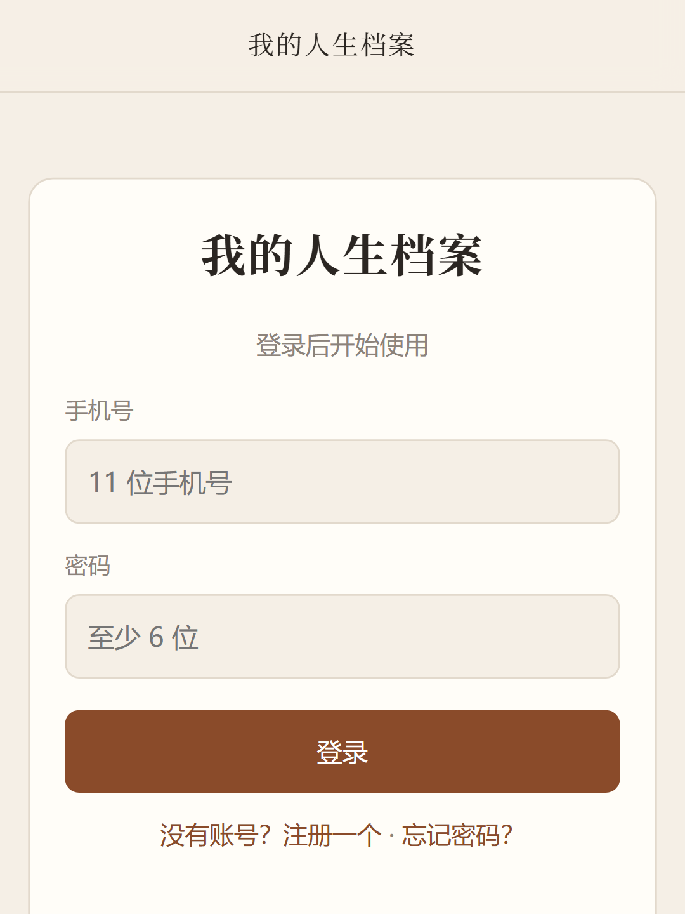
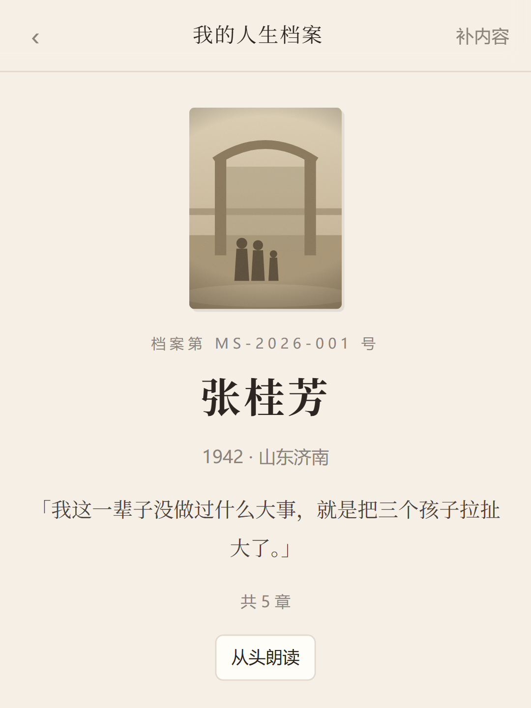
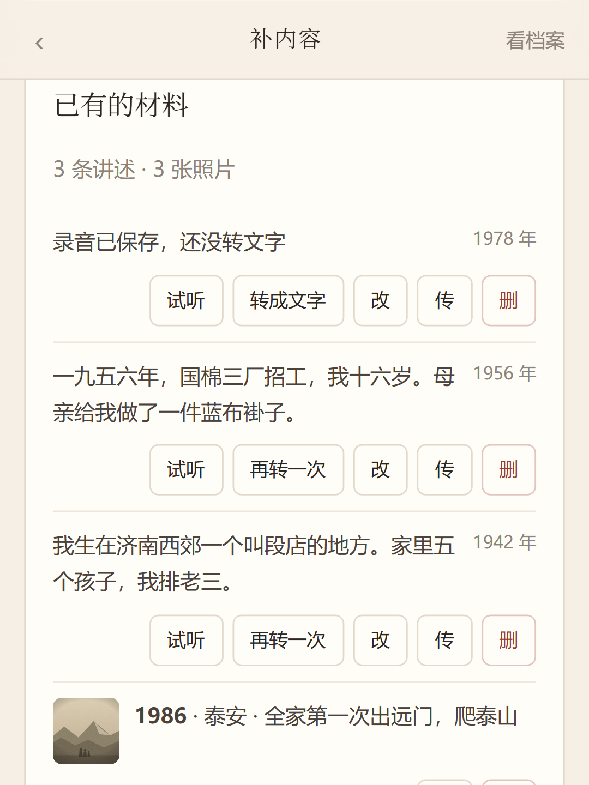
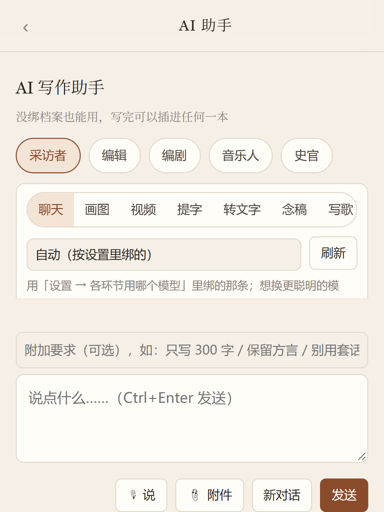
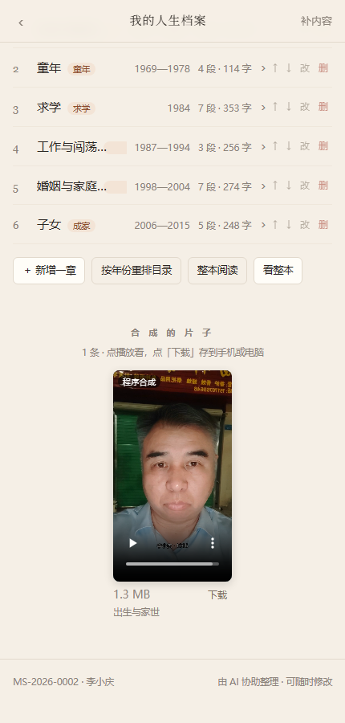
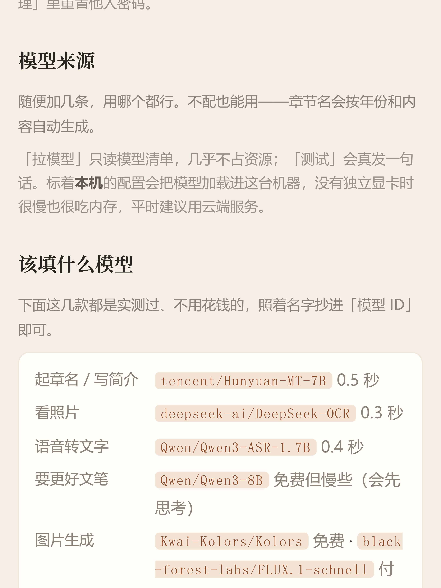

> 导读：这是一篇写给中老年朋友的软件说明书，也是写给年轻朋友的告白——我们总说要多陪陪爸妈，可爸妈的故事，你真的听过、记下来过吗？我花了两个多月，写了一个完全免费、数据不出门的「人生档案」程序：老人口述，它转文字、配插图、排成书、做成漫画和短片，甚至能把一段人生**唱成一首歌**。今天把下载安装、每一步操作、免费 AI 怎么配，一次性讲清楚。手机电脑都能用，不识字多的老人也能上手。

---

## 一、起源：爸妈的故事，不能再等了

去年我回家，翻出一本相册。我妈指着一张泛黄的照片说："这是 1978 年，我考完试在厂门口拍的。"然后她讲了四十分钟那个夏天——粮票、车间、夜校、第一次拿工资。

我听得入迷，可转念一想：这些话，录下来了吗？写下来了吗？等我们再忙两年，谁来记得？

市面上的软件要么要充会员，要么数据存在别人服务器上，要么界面花里胡哨，老人点三下就迷路了。索性自己写一个。目标只有三条：

1. **数据百分之百在本机**——档案、照片、录音都在自己电脑/手机里，不上传任何服务器；
2. **不花钱也能用**——AI 能力全部接免费模型，教程在本文第六节；
3. **老人独立操作**——大按钮、大字、每一步只做一件事。

这个程序叫**「我的人生档案 · MyLife」**，开源，免费，无广告，无任何联网上传。

## 二、它能做什么：一句话简介 + 全景截图

一句话：**老人说，它来记；记完了，还能"出版"。**

具体有八般武艺：

- **录音口述 → 自动转文字**：点一下"说"，讲完再点一下存档，AI 自动转成文字，普通话方言都行；
- **照片管理**：老照片拍下来存进去，写上年份、地点、事件，AI 还能"看照片"帮着写说明；
- **自动成书**：讲述按年代排进章节，自动起章名、编目录、画封面，随时导出成文件，换机搬家不丢；
- **AI 助手八般武艺**：聊天陪访、画插图、生视频、照片识字、语音转文字、朗读念稿、写歌、**真作曲**；
- **漫画**：一个章节自动排成竖版分页漫画，气泡里就是老人口述的原话；
- **短片**：一章讲述自动生成带配音、配乐、字幕的竖屏小电影，发家庭群特别受欢迎；
- **主题曲**：把档案变成歌词，配上旋律——真的大模型作曲，我给父亲那本档案做了一首《1978年的夏天》，三分十一秒，老人听了眼眶红了。

看几张实际界面（均为手机比例，程序在电脑上也是这个样子）：

第一次打开就这一屏：输手机号、设个密码，就注册好了。没有验证码短信、没有第三方授权、没有隐私协议弹窗。

这是一本档案的"卷宗"：封面、生平、章节目录，一本档案就是一个人的一生。

"已有的材料"页：每段讲述都能**试听原音**、看转写文字；照片按章节归档。录错了？点删除重来，老人怎么折腾都不怕。

AI 助手页：上面选角色（采访者/编辑/编剧/音乐人/史官），中间选本领（聊天、画图、视频、提字、转文字、念稿、写歌、作曲），下面打字或按住"说"就行。

作曲档：选个曲风（民谣/怀旧/戏曲等），写一句描述，点"开始作曲"，一两分钟后一首完整的歌就出来了——有人声、有伴奏，是音乐大模型真唱的。

合成好的短片：竖屏、带字幕、有配音配乐，直接在手机上看，也可下载转发。

## 三、架构一分钟（技术朋友看，可跳过）

- **后端**：Node.js 22 + 自带 SQLite，零第三方依赖，单文件就能跑；
- **前端**：原生 JavaScript（ES5 级兼容），老旧安卓手机也能流畅用；
- **打包**：Node 官方 SEA（Single Executable Application）打成单文件程序，ffmpeg 都内嵌了；
- **跨平台**：Windows / Linux / macOS 三个单文件版 + 安卓 APK，全部由 GitHub Actions 云端自动构建；
- **AI 接入**：OpenAI 兼容接口，内置硅基流动、智谱、阶跃星辰等预设，填一个 Key 就能用；
- **每个账号一个独立数据库**，互不干扰；**绝不联网上传**，AI 调用是你自己的 Key 直连模型厂商。

## 四、下载与安装（照着做就行）

**程序开源仓库（推荐从这里进）：**
- GitHub（主仓库，云端打包）：https://github.com/ximyma/mylife
- Gitee（国内源码镜像）：https://gitee.com/ximyma/mylife1

**安装包直链（GitHub 云端打包产物，下载前需免费注册/登录一个 GitHub 账号）：**

| 平台 | 下载链接 |
| --- | --- |
| Windows 单文件版 | https://github.com/ximyma/mylife/actions/runs/40814244066/artifacts/12871249123 |
| 安卓 APK | https://github.com/ximyma/mylife/actions/runs/40814244066/artifacts/12871955793 |
| macOS（苹果芯片） | https://github.com/ximyma/mylife/actions/runs/40814244066/artifacts/12871702241 |
| Linux | https://github.com/ximyma/mylife/actions/runs/40814244066/artifacts/12871901329 |

> 小提示：Artifacts 页面显示的是压缩包大小（几十 MB），**下载后先解压**，里面才是真正的程序（Windows 版解压出来约 150 MB，ffmpeg 已内置，无需另装）。

**Windows 安装：** 下载 → 解压 → 双击 `MyLife.exe` → 浏览器自动打开页面。黑窗口别关，关了程序就停了。想换端口：`set PORT=4401 && MyLife.exe`。

**安卓安装：** 把 APK 传到手机 → 点开安装 → 提示"未知来源"时允许一次。装完桌面出现"我的人生档案"图标。

**彻底卸载：** 删掉整个文件夹即可，程序不在系统任何地方留东西。

## 五、第一次使用：三步走

1. **注册账号**：打开程序，手机号 + 密码（至少 6 位），点"注册一个"。第一个注册的账号会自动接管电脑上的历史数据。
2. **建一本档案**：首页点"新建"，填上老人的姓名、出生年、籍贯。一本档案 = 一个人的一生。
3. **开始录音**：进档案 → "补内容" → 点一下"说"，开讲；讲完再点一下，**先按播放条听一遍**，满意再点"存为一条讲述"，最后点"转成文字"。

就这么简单。剩下的（排版、章节、目录）程序自动做。

## 六、免费 AI 怎么配（重点！照抄就能用）

程序不配 AI 也能用（录音、存照片、导出都正常），但转文字、画图、作曲需要 AI。**下面这些模型实测免费**：

> 💡 **一键注册硅基流动（点我的邀请链接，你我都能得平台赠送额度）**：
> **https://cloud.siliconflow.cn/i/oSZ7RcMc**
> 打开就是注册页，手机号 + 验证码即可，30 秒搞定。免费模型不扣费、不用实名。

> 💡 **智谱 bigmodel 也有大礼包（点我的邀请链接注册送 2000 万 Tokens）**：
> **https://www.bigmodel.cn/invite?icode=WAwAU1lS%2F%2F6gb1nF7hLtY1wpqjqOwPB5EXW6OL4DgqY%3D**
> Flash 系列永久免费，新一代旗舰 GLM-5.3 已上线；接口地址填 `https://open.bigmodel.cn/api/paas/v4`。

| 用途 | 免费模型（设置页可一键选用） |
| --- | --- |
| 起章名、写简介 | Tencent/Hunyuan-MT-7B |
| 看照片写说明 | deepseek-ai/DeepSeek-OCR |
| 语音转文字 | Qwen/Qwen3-ASR-1.7B |
| 更好的文笔 | Qwen/Qwen3-8B |
| 生成插图 | Kwai-Kolors/Kolors、FLUX.1-schnell |
| 作曲唱歌 | 阶跃星辰 stepaudio-3-music-preview（限时免费） |

配置步骤（以主力平台**硅基流动**为例，全程 5 分钟）：

1. **打开平台**：浏览器访问我的邀请链接 **https://cloud.siliconflow.cn/i/oSZ7RcMc**（程序里"设置 → 模型来源 → 平台注册入口"也有这个链接，点开即可）；
2. **注册登录**：手机号 + 验证码注册，免费，不用实名也能用免费模型；
3. **获取 API 密钥**：登录后点左侧「API 密钥」→「新建 API 密钥」→ 复制那串字符（形如 `sk-xxxx`）；
4. **程序里配置**：打开程序 → 设置 → 模型来源 → 添加 → 服务商选「硅基流动」（网址自动填好）→ 粘贴密钥 → 点「拉模型」（自动列出可用模型）→ 点「测试」（真发一句话验证）→ 保存；
5. **各环节分派**：在"设置 → 各环节用哪个模型"里，把转文字、画图、起章名等环节指到上表对应的免费模型即可。

**作曲功能的额外一步**：作曲用的是阶跃星辰的音乐大模型。到 `https://platform.stepfun.com` 注册 → 左侧「API 密钥」新建并复制 → 程序"模型来源"里添加「阶跃星辰（能作曲）」→ 粘贴密钥保存，然后到设置里把"作曲"环节绑上去。它家音乐模型限时免费，抓紧用。

> 安全说明：API 密钥只存在你自己这台设备上，程序不收集、不上传任何东西。

## 七、操作步骤·手把手版（给不熟悉手机的爸妈）

**录一段讲述，一共就四个大按钮：**

1. 打开程序，点那本档案的封面；
2. 点下面的「补内容」三个字；
3. 点**大圆按钮「说」**——看到按钮变成红色，就对着手机讲，像打电话一样；
4. 讲完再点一下红按钮，先**按播放条听一遍**：听得到自己的声音，点「存为一条讲述」；听不到，检查手机壳有没有挡住下面的麦克风孔（设置页有「麦克风诊断」，点一下自己检查）。

存好以后点「转成文字」，十秒钟后你讲的话就变成了一行行文字，自动归进对应章节。**改都不用改**——程序保留录音原音，文字只是给你和儿孙看的"字幕"。

**给老人装程序的儿女们，这样远程帮装：**

1. 您在自己手机上把 APK 或 Windows 包下载好（见第四节链接）；
2. 微信把文件发给爸妈，教他们"点一下、再点一下安装"；
3. API 密钥这类"技术活"您在自己手机上做好，然后让爸妈把程序首页的「导出」文件发给您？——不用！Key 只存在本机，最简单的办法是您登录视频电话一步一步指，或者把本文第六节那五步念给他们听；
4. 实在不行：您先在自己手机装一个，录一段示范给爸妈看——老人学得比您想象快。

## 八、案例演示：王德福的一生（40 分钟做完一本书）

我拿虚构人物"王德福，1948 年生，山东淄博人"做了一次完整演示，全程 40 分钟：

1. 录了 12 段讲述（每段 2–3 分钟），AI 全部转成文字，方言口音识别率很好；
2. 拍了 3 张老照片传进去，AI 补写说明；
3. AI 自动分了 6 章：童年与家世 / 进厂 / 成家 / 女儿出生 / 退休 / 含饴弄孙；
4. 点"生成插图"，每章配了一张年代感插画；
5. 把"进厂"一章做成漫画，把"退休"一章做成 1 分 20 秒的短片；
6. 最后给整本档案做了一首民谣主题曲。

最后导出成一个档案文件发给女儿——她说"爸这辈子第一次被出书"。

**再说说真作曲**。这不是配乐朗诵：音乐大模型先按描述自己写词、自己谱曲、自己"唱"出来。我给一本 1978 年高考背景的档案填了一句"温暖的民谣，木吉他与人声，唱一位老人回忆1978年高考那年的夏天"，一分多钟后拿到一首**3 分 11 秒的完整歌曲**——有人声、有吉他伴奏、有主歌副歌，直接可以刻进档案当主题曲。模型限时免费，一首歌的成本是零。老人在"写的歌"区块按下播放键，听见机器把自己的一生唱出来的那一刻，比任何功能演示都有说服力。

## 九、数据安全与备份

- 所有数据在程序文件夹的 `data\` 里（安卓在应用私有目录），**备份 = 拷贝这一个文件夹**；
- 也可以在首页点「导出」，整本档案变成一个文件，微信发给儿女，对方「导入」即还原；
- 换手机、换电脑：导出 → 新设备导入，一分钟搬完家。

## 十、常见问题

- **不会打字怎么办？** 全程用说的。录音按钮很大，讲完先听再存。
- **没配 AI 能用吗？** 能。录音、照片、导出、阅读都不受影响。
- **免费模型会不会哪天收费？** 会变。程序支持任意 OpenAI 兼容平台，换一家换个 Key 就行；文中的模型清单也会随版本更新。
- **黑白屏、打不开？** Windows 下黑窗口是最小化不是闪退；杀毒软件首次运行可能拦截，选"允许"即可。
- **数据丢了怎么办？** 只要 `data\` 文件夹在，一切都在。建议每月拷一次到 U 盘。

## 十一、写在最后

这个程序的所有代码开源在 GitHub（https://github.com/ximyma/mylife），Windows、Linux、macOS、安卓四个平台的安装包都是云端自动构建的，随时可下载。如果你会写代码，欢迎提 Issue、提 PR；如果你的爸妈也有故事，今晚就可以开始录第一段。

**给爸妈装一个，从"妈，你小时候过年是什么样的"开始。**

最后再放一次免费 AI 的注册入口（注册就用得上）：
硅基流动 **https://cloud.siliconflow.cn/i/oSZ7RcMc**；
智谱 bigmodel（注册送 2000 万 Tokens）**https://www.bigmodel.cn/invite?icode=WAwAU1lS%2F%2F6gb1nF7hLtY1wpqjqOwPB5EXW6OL4DgqY%3D**

做的事会过期，记下来的不会。

---

*作者：笑卿（公众号：笑卿微道）｜程序开源地址：https://github.com/ximyma/mylife*
